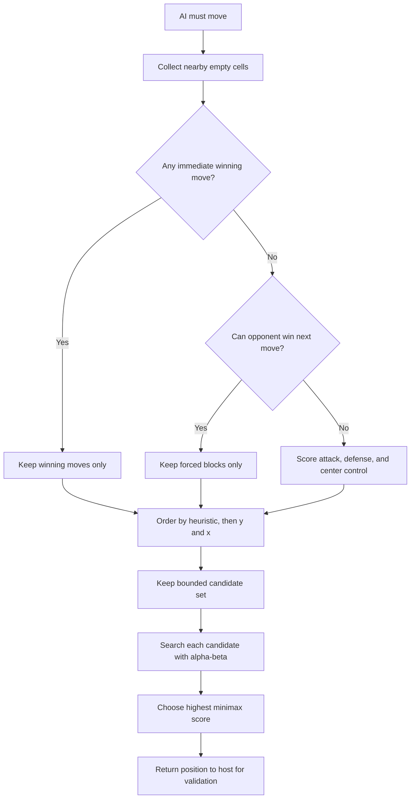
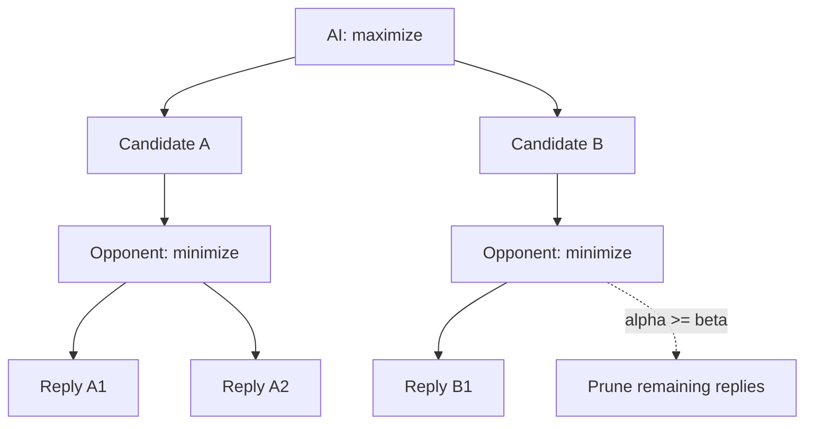
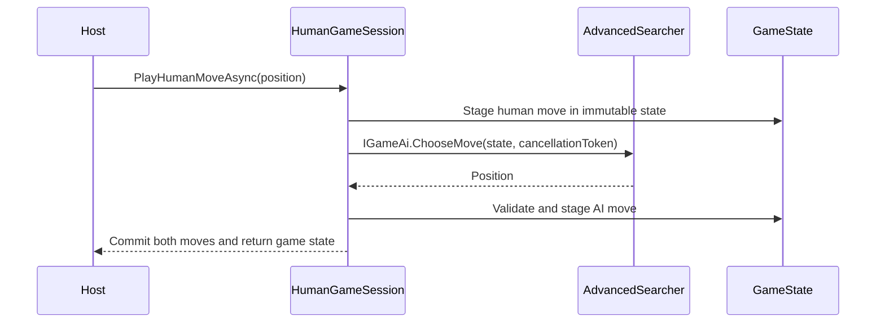

# Advanced Search v1 AI

`Xo.Ai.AdvancedV1` is an in-process C# AI class library implementing
[`IGameAi`](../../shared/Xo.Ai.Abstractions/IGameAi.cs).
It combines immediate win and block
checks with bounded candidate generation, heuristic ordering, and deterministic
alpha-beta search with practical response times on a 20x20 board.
Its registered component ID is `xo-ai-advanced-v1`.

## Move-selection pipeline



### 1. Candidate generation

Searching every empty square at every ply is too expensive on a 20x20 board.
After play begins, the search considers empty cells in a radius-two square
around every recorded move:

```text
+---+---+---+---+---+
| . | . | . | . | . |
+---+---+---+---+---+
| . | . | . | . | . |
+---+---+---+---+---+
| . | . | X | . | . |   Every empty cell shown is a candidate
+---+---+---+---+---+
| . | . | . | . | . |
+---+---+---+---+---+
| . | . | . | . | . |
+---+---+---+---+---+
```

Duplicates from overlapping neighborhoods are removed with a `HashSet`. On an
empty board there is exactly one candidate: the lower coordinate of the
geometric center. If a non-empty position has no nearby empty cell, the search
falls back to scanning all empty cells.

### 2. Tactical filtering

Before applying the candidate limit, `WouldWin` counts contiguous stones in
both directions along the four Gomoku axes:

```text
horizontal       vertical         diagonal         anti-diagonal
<----->             ^                /                  \
                    |               /                    \
                    v              /                      \
```

The candidate list is reduced according to this priority:

```text
winning moves for side to move
└── none: moves that stop an opponent win next turn
    └── none: highest-ranked positional candidates
```

This ensures a direct win is taken and a single immediate threat is blocked
before deeper search or static scoring can distract the AI.

### 3. Heuristic ordering

Each candidate is ranked with:

$$
H(p) = P_{self}(p) + 1.1P_{opponent}(p) + C(p)
$$

`PatternPotential` examines every five-cell window containing the candidate in
all four directions. A window contributes only when it stays on the board and
contains no opposing stone. Including the candidate, its contribution is:

| Stones in window | Score |
| ---: | ---: |
| 5 | 1,000,000 |
| 4 | 35,000 |
| 3 | 3,000 |
| 2 | 250 |
| 1 | 8 |

Opponent potential is weighted 10% more heavily during move ordering, making
urgent defensive cells rank slightly above equally developed attacks. A small
center bonus breaks otherwise quiet positional ties. Final ties use ascending
`y`, then ascending `x`.

### 4. Alpha-beta tree

The ordered candidates form a depth-limited minimax tree. The AI maximizes its
score; the opponent minimizes it. Alpha-beta bounds stop exploring a branch
once it cannot change the result already available to an ancestor.



The configured candidate limit applies at the root. Deeper plies reduce the
limit by two per level, with a floor of six:

$$
L_{ply} = \max(6, L_{root} - 2 \cdot ply)
$$

At the default depth of 3, the tree includes the AI move, the opponent reply,
and the AI continuation.

### 5. Leaf evaluation

Terminal wins and losses receive scores near $\pm 10{,}000{,}000$, with a small
depth adjustment that prefers earlier wins and delays losses. Draws score zero.

A non-terminal leaf compares the two best attacking and defensive
opportunities:

$$
E = A_1 + \frac{A_2}{3} - 1.1D_1 - \frac{D_2}{3}
$$

Considering the second-best pattern helps recognize fork-like positions where
more than one continuation matters.

## Determinism

The search has no randomness or internal time-based cutoff. Host cancellation
and a cooperative move deadline can interrupt it. Completed searches with
the same state and settings
produce the same move because:

- candidate ordering ends with `y`, then `x`;
- equal root scores retain the first ordered candidate;
- search depth and branching limits are fixed before the move starts.

This is useful for repeatable benchmarks, although a fixed-depth search cannot
trade spare time for deeper analysis.

## In-process game flow



The AI receives the complete immutable host state. It does not own a second
game history or record its returned move. If the AI is X, the host asks it
to choose from an empty board. Human turns commit only after the AI reply
has been validated, permitting retry after failure.

## Settings

| Constructor argument | Default | Clamped range | Purpose |
| --- | ---: | --- | --- |
| `depth` | `3` | `1` to `5` | Search plies, including the root move |
| `candidateLimit` | `14` | `4` to `30` | Maximum candidates retained at the root |

Board dimensions/origin and the side to move come from the supplied state.

Higher depth and candidate counts improve coverage but multiply work. With a
rough branching limit $L$ and depth $D$, the upper bound is approximately
$O(L^D)$ nodes before tactical filtering and alpha-beta pruning.

The search-specific overload returns a `SearchResult` containing:

- `score`: minimax score selected at the root;
- `nodes`: alpha-beta nodes visited;
- `depth`: configured search depth;

The shared game interface returns only `Position`. The host measures and
records elapsed time separately.

## Current boundaries

The implementation is tactical rather than tournament-grade. It has no opening
book, transposition table, iterative deepening, time budget, symmetry cache, or
threat-space solver. It implements freestyle five-or-more wins through the
shared domain engine; it does not implement Renju forbidden-move rules.

## Run it

From the repository root:

```bash
dotnet run --project src/web/Xo.Web.Api --urls http://localhost:8080
```

Select **Advanced Search v1 (C#)** in Play or Arena. It runs in the web process.

## Code map

- [`AdvancedSearcher.cs`](AdvancedSearcher.cs) implements candidates, tactical
  filtering, pattern scores, alpha-beta recursion, and leaf evaluation.
- [`Xo.Ai.AdvancedV1.csproj`](Xo.Ai.AdvancedV1.csproj) defines the C# class library
  and its shared interface/domain dependency.
